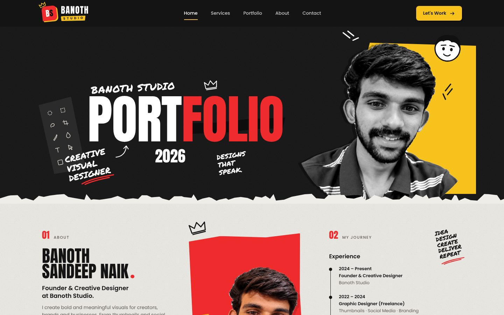
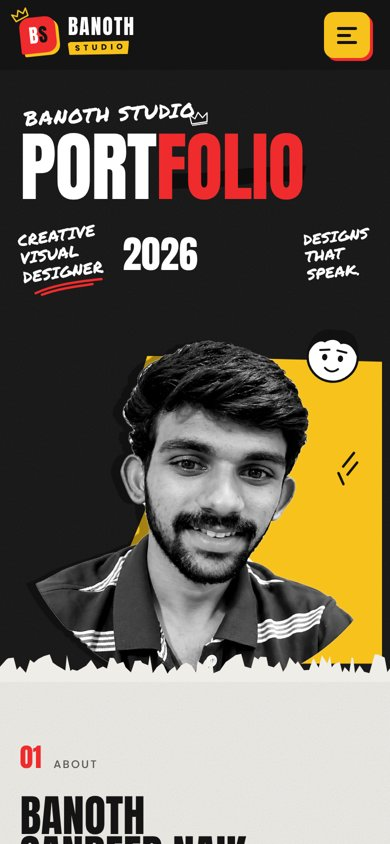
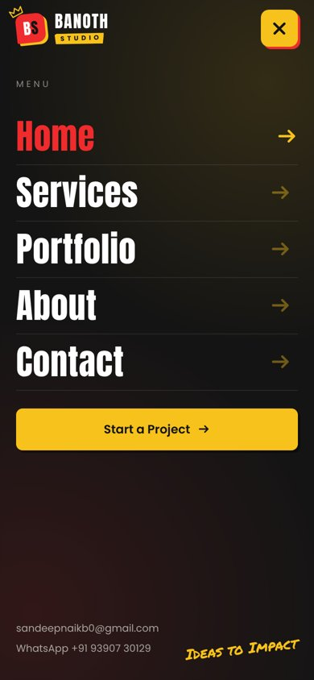
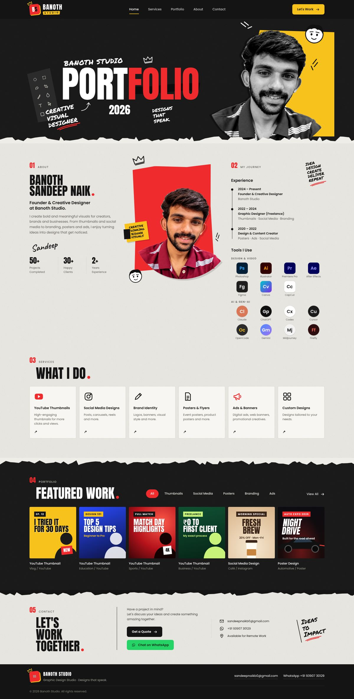

<div align="center">

# BANOTH STUDIO

### Designs that speak.

Portfolio website for **Banoth Studio**, the graphic design studio of **Banoth Sandeep Naik**.<br />
YouTube thumbnails · Social media · Brand identity · Posters · Ads

<br />


<br />



</div>

<br />

## ✦ Preview

<table>
  <tr>
    <td width="50%" align="center"><br /><sub><b>Mobile</b> — hero</sub></td>
    <td width="50%" align="center"><br /><sub><b>Mobile</b> — full-screen menu</sub></td>
  </tr>
</table>

<details>
<summary><b>View the full page</b></summary>
<br />

</details>

<br />

## ✦ Features

| | |
|---|---|
| 🎬 **Intro loader** | Logo stamp, rising wordmark, progress bar. Plays once and lifts away with a torn-paper edge. Pure CSS. |
| 📌 **Sticky navbar** | Stays on top, compacts on scroll, highlights the section on screen. |
| 📱 **Mobile menu** | Full-screen menu that opens in a circle from the button, with staggered links. Closes on link tap or <kbd>Esc</kbd>. |
| 🧰 **Tools I Use** | Design & video tools (Photoshop, Illustrator, Premiere Pro, After Effects, Figma, Canva, CapCut) and AI tools (Claude, ChatGPT, Codex, Cursor, OpenCode, Gemini, Midjourney, Firefly). |
| 🗂️ **Portfolio filter** | All / Thumbnails / Social Media / Posters / Branding / Ads. Works without JavaScript. |
| 💬 **Direct contact** | *Get a Quote* opens a pre-filled email. *Chat on WhatsApp* opens a chat with a ready message. |
| ✂️ **Torn-paper style** | Ripped edges, marker notes, doodles and tape. All drawn in SVG/CSS, no image files. |
| ♿ **Accessible** | Keyboard focus states, ARIA on the menu, and reduced-motion support. |

<br />

## ✦ Sections

```
01  About          name, bio, signature, stats
02  My Journey     experience timeline + tools
03  What I Do      6 services
04  Featured Work  filterable mockups
05  Contact        quote, WhatsApp, details
```

<br />

## ✦ Getting started

```bash
git clone https://github.com/mrbanoth/banothstudio.git
cd banothstudio
npm install
npm run dev
```

Open **http://localhost:3000**.

| Command | What it does |
|---|---|
| `npm run dev` | Start the dev server |
| `npm run build` | Production build |
| `npm start` | Serve the production build |
| `npm run export` | Static site in `out/` for Netlify, GitHub Pages or Hostinger |

<br />

## ✦ Project structure

```
banothstudio/
├── app/
│   ├── layout.js        # fonts, metadata, viewport
│   ├── page.js          # all sections + content arrays (services, tools, aiTools, work)
│   └── globals.css      # design tokens, layout, responsive rules
├── components/
│   ├── Nav.js           # sticky navbar + mobile menu (client)
│   ├── Loader.js        # intro screen
│   ├── Logo.js          # BS monogram + wordmark
│   ├── Mockup.js        # Featured Work mockups
│   ├── Doodles.js       # torn edges, crown, arrows, sticker
│   └── site.js          # email, WhatsApp, year
├── public/              # photos
└── docs/                # README screenshots
```

<br />

## ✦ Customize

**Contact details:** edit `components/site.js` once and it updates everywhere.

```js
export const EMAIL = 'sandeepnaikb0@gmail.com';
export const PHONE = '9390730129';
```

- **Content.** The services, journey, tools and work items are arrays at the top of `app/page.js`.
- **Colours and fonts.** Change the tokens in `:root` in `app/globals.css`.

  | Token | Colour |
  |---|---|
  | `--red` | `#ef2b2d` |
  | `--yellow` | `#f7c21b` |
  | `--ink` | `#141414` |
  | `--paper` | `#efede8` |

- **Real work in place of mockups.** Put images in `public/work/` and swap `<Mockup m={w.m} />` for an `` in `app/page.js`.
- **Photos.** Replace `public/photo-bw.webp` (hero) and `public/photo-color.webp` (about). Transparent cut-outs look best.

<br />

## ✦ Typography

**Anton** for headlines · **Permanent Marker** for hand-written notes · **Caveat** for the signature · **Poppins** for body text

<br />

## ✦ Contact

<div align="center">

**Banoth Sandeep Naik** — Founder & Creative Designer

📧 [sandeepnaikb0@gmail.com](mailto:sandeepnaikb0@gmail.com) &nbsp;·&nbsp; 💬 [WhatsApp +91 93907 30129](https://wa.me/919390730129) &nbsp;·&nbsp; 🐙 [@mrbanoth](https://github.com/mrbanoth)

<br />

<sub>© 2026 Banoth Studio. All rights reserved.</sub>

</div>
